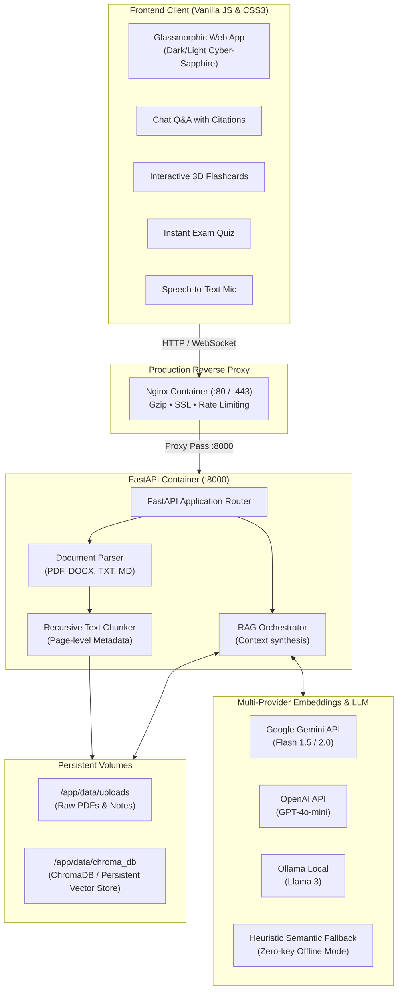

# 🎓 StudySphere AI: Docker-Enabled Study Material Q&A on Cloud

[](https://fastapi.tiangolo.com)
[](https://www.docker.com/)
[](https://www.python.org/)
[](https://aistudio.google.com/)
[](https://platform.openai.com/)
[](LICENSE)

> A modern, production-ready, containerized AI assistant designed for students and educators. Upload lecture slides, textbooks, research papers, and notes (PDF, DOCX, TXT, MD) to query them with **Retrieval-Augmented Generation (RAG)**, exact page citations, interactive 3D flashcards, and automated exam practice quizzes.

---

## 🌟 Key Highlights

- **Multi-Provider AI Engine**: Seamlessly switch between **Google Gemini** (generous free tier), **OpenAI** (GPT-4o), or **Ollama** (100% offline local models) without restarting the container.
- **Precision RAG with Exact Citations**: Answers cite the exact page number and text snippet. Click any citation chip to open a dedicated drawer with the original source context and semantic similarity score.
- **Dynamic Study Modes**:
  - 💬 **Deep Q&A**: University-level academic tutor with step-by-step reasoning.
  - 🐣 **ELI5 Simple**: Intuitive analogies and clear explanations without complex jargon.
  - 🎯 **Exam Prep**: Focuses on high-yield formulas, common pitfalls, and definitions to memorize.
  - 📑 **Revision Guide**: Generates structured summaries with takeaways and professor tips.
- **Interactive Active-Recall Flashcards**: 3D perspective flip cards with flip keyboard shortcuts (`Space`), card navigation, and mastery progress tracking.
- **Practice Exam Quiz Generator**: Generates multiple-choice quizzes with instant visual feedback (green/red) and deep pedagogical explanations.
- **Voice Input (Speech-to-Text)**: Built-in Web Speech API microphone dictation for hands-free studying.
- **Production-Ready Docker Architecture**: Multi-stage lightweight Docker image hardened with non-root security (`appuser`), Nginx reverse proxy, gzip compression, rate limiting, and volume persistence for both uploaded documents and vector embeddings.
- **Instant Demo Mode**: Pre-loaded with comprehensive Computer Science Operating Systems & Machine Learning revision guides for 1-click exploration.

---

## 🏛️ System Architecture



---

## 🚀 Quick Start Guide

### Option 1: Docker Compose (Recommended)

1. **Clone the repository**:
   ```bash
   git clone <repository-url>
   cd "AI ChatBot"
   ```

2. **Configure your API keys**:
   ```bash
   cp .env.example .env
   # Edit .env and paste your GEMINI_API_KEY or OPENAI_API_KEY
   ```

3. **Start the containers**:
   ```bash
   docker compose up -d --build
   ```

4. **Access the application**:
   - Open your browser at **`http://localhost`** (Nginx proxy) or **`http://localhost:8000`** (Direct backend).
   - Check container health: `curl http://localhost/health`

To stop:
```bash
docker compose down
```

---

### Option 2: Running Locally (Windows / macOS / Linux)

1. **Install Python dependencies**:
   ```bash
   python -m pip install -r requirements.txt
   ```

2. **Configure `.env`**:
   ```bash
   cp .env.example .env
   ```

3. **Launch the application**:
   - On Windows: double-click `scripts\run_local.bat` or run:
     ```bash
     python run.py
     ```
   - On Linux/macOS:
     ```bash
     python3 run.py
     ```

Open **`http://localhost:8000`** in your browser.

---

## ☁️ Cloud Deployment Options

| Cloud Provider | Recommended Service | Deployment Command / Guide |
|---|---|---|
| **Google Cloud** | Cloud Run (Serverless) | `gcloud run deploy --source . --port 8000` |
| **AWS** | EC2 + Docker Compose | See [DEPLOYMENT.md](file:///c:/Users/krish/Desktop/AI%20ChatBot/DEPLOYMENT.md#3-aws-deployment) |
| **AWS** | ECS Fargate | Containerized task definition mapping port 8000 |
| **Microsoft Azure** | Azure Container Apps | `az containerapp up --source . --target-port 8000` |
| **DigitalOcean** | App Platform / Droplet | Dockerfile auto-detected on git push |
| **Render / Railway** | Web Service | Connect repository, auto-deploys via Dockerfile |

> Detailed step-by-step instructions with SSL/TLS Certbot instructions are documented in [DEPLOYMENT.md](file:///c:/Users/krish/Desktop/AI%20ChatBot/DEPLOYMENT.md).

---

## 📡 REST API Reference

| Method | Endpoint | Description |
|---|---|---|
| `GET` | `/` | Web application shell (HTML5) |
| `GET` | `/health` | Container healthcheck & vector store telemetry |
| `POST` | `/api/upload` | Multipart file upload (`.pdf`, `.docx`, `.txt`, `.md`) |
| `POST` | `/api/sample/load` | 1-Click preload of OS and ML study guides |
| `GET` | `/api/documents` | Lists all active indexed documents with page & chunk counts |
| `DELETE` | `/api/documents/{doc_id}` | Deletes document and removes embeddings from vector index |
| `POST` | `/api/chat` | RAG Q&A query with conversation history & citations |
| `POST` | `/api/study/flashcards` | Generates active-recall flashcards with categories |
| `POST` | `/api/study/quiz` | Generates interactive practice exam quiz |
| `POST` | `/api/study/summary` | Generates structured markdown study guide & takeaways |
| `GET` | `/api/settings` | Gets active provider configuration |
| `POST` | `/api/settings` | Updates active provider & API keys dynamically |

---

## 📂 Project Structure

```
AI ChatBot/
├── app/
│   ├── main.py                  # FastAPI server, endpoints, static file mounting
│   ├── config.py                # Pydantic Settings, environment variable loading
│   ├── models/
│   │   └── schemas.py           # Request / Response Pydantic models
│   ├── services/
│   │   ├── document_parser.py   # PDF (pypdf), DOCX, TXT, MD parser
│   │   ├── text_splitter.py     # Recursive text chunker with overlap & page metadata
│   │   ├── vector_store.py      # Hybrid Vector Store (ChromaDB + Persistent Native Store)
│   │   ├── embeddings.py        # Multi-provider embeddings (Gemini, OpenAI, Native)
│   │   ├── llm_service.py       # Multi-provider LLM caller (Gemini, OpenAI, Ollama)
│   │   └── rag_engine.py        # RAG pipeline, context synthesis & citation builder
│   ├── static/
│   │   ├── css/
│   │   │   ├── main.css         # Glassmorphism design system & variables
│   │   │   └── components.css   # Chat, flashcards, quiz, modals, and sidebar styles
│   │   └── js/
│   │       ├── api.js           # REST API fetch client
│   │       ├── chat.js          # Chat handling, citations drawer & voice input
│   │       ├── study_tools.js   # 3D Flashcards, Quiz engine, and Summary generator
│   │       └── app.js           # App coordinator, theme toggle & document manager
│   └── templates/
│       └── index.html           # Modern semantic HTML5 application shell
├── data/
│   ├── uploads/                 # Storage for uploaded study documents
│   └── chroma_db/               # Vector database persistence
├── sample_materials/            # Preloaded study guides for instant testing
│   ├── Operating_Systems_Study_Guide.txt
│   └── Machine_Learning_Fundamentals.md
├── docker/
│   ├── Dockerfile               # Multi-stage production container image
│   ├── docker-compose.yml       # Production orchestration (App + Nginx)
│   └── nginx.conf               # Nginx reverse proxy configuration
├── scripts/
│   ├── run_local.bat            # 1-Click Windows launcher
│   └── start.sh                 # Linux container entrypoint
├── tests/
│   ├── test_rag.py              # Unit tests for chunking, parser, and vector store
│   └── test_api.py              # Integration tests for FastAPI endpoints
├── Dockerfile                   # Root Dockerfile for cloud deployers
├── docker-compose.yml           # Root Docker Compose file
├── requirements.txt             # Python dependencies
├── .env.example                 # Environment configuration template
├── DEPLOYMENT.md                # Cloud deployment guide
└── README.md                    # Project documentation
```

---

## 🧪 Testing

Run the test suite with:
```bash
# Run RAG unit tests
python tests/test_rag.py

# Run API integration tests
python tests/test_api.py
```

---

## 🛡️ License

This project is licensed under the MIT License - see the LICENSE file for details.
